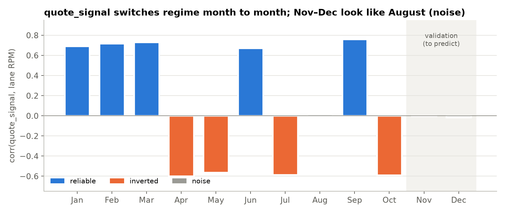
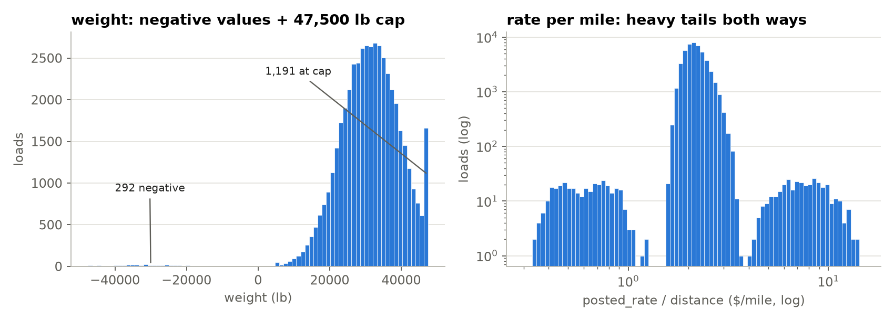
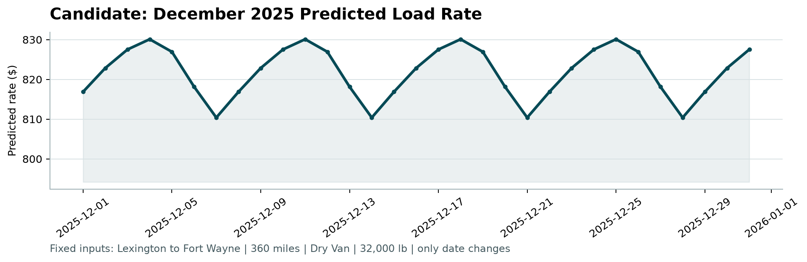

# Freight Rate Prediction — US Full-Truckload Posted Rates

Predicts the `posted_rate` ($) of a truckload from lane, equipment, weight and date. The model is trained on 48,000 labelled loads (Jan–Oct 2025) and scored on 12,000 future loads (Nov–Dec 2025).

**Deliverables**

| File | What it is |
|---|---|
| [`validation_predictions.csv`](validation_predictions.csv) | 12,000 rows, `load_id,predicted_rate` (passes `score.py`) |
| [`reports/Freight_Rate_Report.pdf`](reports/Freight_Rate_Report.pdf) | Report: split/validation approach + December chart |
| [`scorer_results/candidate_december.png`](scorer_results/candidate_december.png) | Fixed December chart produced by the provided `score.py` |
| [`data/december_chart_inputs.csv`](data/december_chart_inputs.csv) | Completed December inputs used for the chart |

---

## TL;DR

1. **`quote_signal` is a trap.** In Jan, Feb, Mar, Jun and Sep it equals the realised rate-per-mile for ~93% of loads. In Apr, May, Jul and Oct it is inversely related. In August it is noise, and in the **entire Nov–Dec prediction set it is noise too**. A model that relies on it scores well on random splits and fails on the period we actually have to predict.
2. **`market_index` level drifts.** Within a month it tracks rates closely, but September has the lowest index of the year with normal rates, so models that use it are biased out-of-time.
3. Validation is **expanding-window, month-ahead time-series CV** (Jun → Oct, five folds) with early stopping on the *training* window only.
4. Final model: **XGBoost + LightGBM + CatBoost blend** predicting **rate-per-mile** with an **L1 (MAE) objective**, without `quote_signal` and `market_index`, 3 seeds each.
5. On the three most recent folds, the final model beats the previous `quote_signal`-based approach every month: **Aug $91 vs $168, Sep $96 vs $110, Oct $101 vs $129**.



---

## Key findings from the data

| Finding | Evidence | What I did |
|---|---|---|
| `quote_signal` switches regime by month | corr(quote_signal, lane RPM) = +0.7 (Jan–Mar, Jun, Sep), −0.6 (Apr, May, Jul, Oct), ≈0 (Aug, **Nov, Dec**) | Excluded from the model |
| `market_index` level drifts vs rates | Within-month daily corr 0.77–0.95, but Sep has the lowest index of the year (0.89) with normal rates | Excluded; month-relative variant tested and rejected (ablation) |
| Per-load `market_index` is noisy | per-load corr with lane-relative RPM 0.08 vs 0.69 for the daily mean | Daily mean used in ablations |
| Negative weights | 292 train / 145 validation, rates match same-magnitude positive weights | Sign error, so `abs()` + flag |
| Weight capped at 47,500 lb | 1,191 train loads at exactly the cap | Kept (legal max) |
| Missing values | weight 300/165, market_index 374/249 (train/validation) | Equipment-median imputation + flags |
| Corrupted labels | ~1.3% of loads priced at 0.2–0.6× or 2–5× their lane's typical rate, in every month | L1 objective + median-based lane priors |
| 8 cities appear only in validation | Chicago, Charlotte, San Diego, Laredo, …; ~1,450 loads | Priors borrowed from the nearest known city (−4% MAE on simulated unseen cities) |
| Clean structure otherwise | No duplicate IDs; each city has one fixed coordinate; median road circuity 1.18 | — |



## Validation design

```
Fold  Train (expanding)        Test
1     Jan 1 – May 31        →  June
2     Jan 1 – Jun 30        →  July
3     Jan 1 – Jul 31        →  August     ← same quote_signal regime as Nov–Dec
4     Jan 1 – Aug 31        →  September
5     Jan 1 – Sep 30        →  October
Final Jan 1 – Oct 31        →  validation.csv (Nov–Dec)
```

* **Why time-based:** the task is to forecast future months. A random split lets the model see the same days and market conditions it is tested on.
* **No leakage:** early stopping uses the last 10% (by date) of each *training* window, never the test month. Imputation statistics and lane/city target priors are fitted on the training window only. Training rows get **out-of-fold** priors.
* **Number of boosting rounds** for the final refit is set by early stopping on a Jan–Sep fit (checked on October), then +10% for the larger refit data.

## Experiments (MAE $, from [`experiments/results/summary.md`](experiments/results/summary.md))

| Experiment | Jun | Jul | Aug | Sep | Oct | Mean |
|---|---:|---:|---:|---:|---:|---:|
| LightGBM + quote_signal + market_index *(previous approach)* | 132.3 | 93.9 | 168.2 | 109.6 | 129.3 | 126.7 |
| XGBoost + quote_signal + market_index | 135.5 | 91.6 | 170.3 | 108.3 | 122.7 | 125.7 |
| XGBoost + market_index (no quote_signal) | 141.8 | 100.0 | 117.1 | 152.8 | 129.6 | 128.3 |
| XGBoost + month-relative market_index | 221.7 | 119.6 | 95.6 | 105.7 | 103.6 | 129.3 |
| XGBoost, core features | 218.7 | 129.2 | 94.1 | 97.4 | 102.5 | 128.4 |
| XGBoost, core features, no lane priors | 221.3 | 129.1 | 92.8 | 97.2 | 102.1 | 128.5 |
| LightGBM, core features | 224.2 | 129.4 | 93.6 | 97.0 | 101.9 | 129.2 |
| CatBoost, core features | 226.0 | 129.6 | 91.4 | 95.9 | 101.0 | 128.8 |
| **Blend XGB + LGB + CatBoost, core features (FINAL)** | 222.8 | 128.7 | **91.3** | **95.6** | **100.7** | 127.8 |
| Baseline: lane median RPM × distance | 206.7 | 190.8 | 216.7 | 199.2 | 201.5 | 203.0 |

**How to read this.** The mean across all five folds is close for every model, so the choice comes down to *which folds look like the prediction period*:

* **Aug–Oct** are the most recent folds, trained on the most history, and August is the only month with the same noise-regime `quote_signal` as Nov–Dec. The core-feature blend wins all three, by up to $77 in August.
* **June** is the weak spot. Rates jumped ~4% that month and only the market index caught it. That signal then broke in September, so I took the model that is robust in the regime we actually have to predict.
* Earlier iterations (v1–v7 in git history: Ridge, log-target, CatBoost, 3-way blends, all with `quote_signal`) were scored on one time-based split (the last 20% of rows, mid-Aug → Oct) and reported ~$111 MAE. That single window mixes three `quote_signal` regimes, so it could not show the failure in the noise regime. That is why the evaluation moved to per-month folds.

## Model

* **Target:** rate-per-mile (`posted_rate / distance`). Dollars = RPM × distance (floored at $50).
* **Loss:** L1 / MAE, the competition metric and robust to the ~1.3% corrupted labels.
* **Features (`src/features.py`):** distance, log distance, great-circle miles, circuity, pickup/delivery coordinates, pickup/delivery city (categorical), equipment, weight (+ missing/negative flags), day of week, smoothed lane × equipment RPM prior, lane count, pickup- and delivery-city RPM priors (nearest-known-city fallback).
* **Models (`src/models.py`):** XGBoost (depth 7), LightGBM (63 leaves), CatBoost (depth 6), equal-weight blend, 3 seeds each.

## December chart

Fixed inputs: Lexington → Fort Wayne, 360 mi, Dry Van, 32,000 lb. Only the date changes. The prediction is $810–$830 (~$2.28/mile, in line with this lane's history), with a weekly cycle that peaks mid-week and dips at weekends.



---

## How to run

```bash
python -m venv .venv
.venv\Scripts\activate          # Windows
# source .venv/bin/activate     # macOS / Linux
pip install -r requirements.txt

python train.py                  # ~8 min: holdout check, refit, predictions, December chart, score.py
```

Reproduce the analysis (optional):

```bash
python experiments/eda.py              # data-quality stats + figures  -> reports/figures/
python experiments/run_experiments.py  # time-series CV comparison      -> experiments/results/summary.md (~25 min)
python experiments/unseen_city_test.py # nearest-city fallback check    -> experiments/results/unseen_city.txt
pip install reportlab && python reports/build_report.py   # -> reports/Freight_Rate_Report.pdf
```

Check the submission files with the provided scorer:

```bash
python score.py --predictions validation_predictions.csv --december-predictions data/december_chart_inputs.csv
```

## Repository layout

```
├── train.py                     # final pipeline: holdout check → refit → predictions → score.py
├── score.py                     # provided scorer (unchanged)
├── src/
│   ├── features.py              # cleaning, imputation, geometry, out-of-fold lane/city priors
│   └── models.py                # XGBoost / LightGBM / CatBoost definitions (RPM target, L1 loss)
├── experiments/
│   ├── eda.py                   # data exploration + figures
│   ├── run_experiments.py       # expanding-window CV model/feature comparison
│   ├── unseen_city_test.py      # simulated unseen-city test
│   └── results/                 # cv_results.csv, summary.md, final_model_metrics.json, ...
├── reports/
│   ├── Freight_Rate_Report.pdf  # submission report
│   ├── build_report.py
│   └── figures/
├── data/                        # train_test.csv, validation.csv, template, december_chart_inputs.csv
├── scorer_results/candidate_december.png
├── validation_predictions.csv
└── requirements.txt
```
