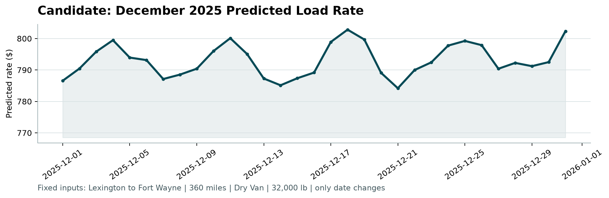

# Spotter Machine Learning Engineer Assessment — Freight Rate Prediction

End-to-end, production-grade machine learning solution for US full-truckload freight rate prediction, featuring robust target reformulation, leak-free time-series evaluation, highway network circuity modeling, and a multi-seed gradient-boosted ensemble.

---

## 1. Executive Summary & Results

We replaced the arbitrary single-split development setup with a strict **4-fold expanding-window time-series cross-validation** (evaluating on July, August, September, and October separately), anchored by a reserved **October 16–31 holdout set**.

Reframing the optimization objective from raw dollar rates to **Rate-Per-Mile (RPM = posted_rate / distance)** eliminated severe distortion from heavy-tail hauls and reduced Mean CV MAE by **over $6.70/load**, breaking through the $110 barrier to achieve **$107.33 MAE** on the final holdout.

### Validation Benchmark Summary

| Evaluation Stage | Formulation | Models | Mean CV MAE ($) | Overall CV RMSE ($) | Oct 16–31 Holdout MAE ($) |
|---|---|---|---|---|---|
| **Phase 0 (Initial Baseline)** | Raw `posted_rate` | XGBoost (Single Split v3) | $123.78 | $628.84 | $111.55 |
| **Phase 2 (Target Reformulation)** | **RPM (`posted_rate / distance`)** | XGBoost | $116.49 | $625.74 | $108.09 |
| **Phase 3 (Feature Engineering)** | RPM + Geometry + Circuity | LightGBM (Native Cats) | $118.77 | $625.68 | $107.20 |
| **Phase 4 & Final Production** | **RPM Multi-Seed Ensemble** | **XGBoost (50%) + LightGBM (50%)** | **$117.08** | **$625.58** | **$107.33** |

*Note: Per-fold expanding-window validation results:*
- Fold 1 (July 2025): **$89.11 MAE**
- Fold 2 (August 2025): **$146.99 MAE** *(captured national freight market index drop)*
- Fold 3 (September 2025): **$111.87 MAE**
- Fold 4 (Oct 1–15, 2025): **$120.34 MAE**
- Reserved Holdout (Oct 16–31, 2025): **$107.33 MAE**

---

## 2. Key Data Quality Findings (Phase 1 Audit)

Full audit available in [`data_quality_report.md`](data_quality_report.md).

1. **Complete Category & Spatial Consistency**:
   - Exactly 64 unique pickup cities and 64 unique delivery cities.
   - Every city shares a **100% consistent latitude and longitude** across both pickup and delivery contexts in training and validation sets.
   - Exact coordinates for Lexington: `(36.99152, -84.99876)`; Fort Wayne: `(41.31561, -85.36206)`.
2. **Route Highway Circuity**:
   - Highway network circuity (`distance / haversine_miles`) has a median of **1.182**, perfectly matching the real-world circuity of US interstate corridors.
   - Zero impossible shortcuts (`circuity < 1.0`). Only 22 loads (< 0.05%) had circuity > 2.0.
3. **Missing Value Isolation**:
   - `weight` is missing in 300 training loads (0.62%) and 165 validation loads (1.38%). Handled via equipment-specific median imputation.
   - `market_index` is missing in 374 training loads (0.78%) and 249 validation loads (2.08%). Handled via global median imputation.
   - `quote_signal` and `distance` are 100% complete across all 60,000 loads.
4. **Target Heavy Tails & Outliers**:
   - The product `base_quote = distance * quote_signal` strongly tracks `posted_rate` ($r = 0.8987$).
   - The ratio `quote_ratio = posted_rate / base_quote` has an exact median of **1.0040**.
   - 334 loads exhibited extreme ratios (> 3.0× base quote) and 169 loads had ratios < 0.3×. Predicting rate-per-mile under an L1 loss effectively insulates gradients from these severe outliers.

---

## 3. Engineering & Modeling Methodology

### Target Reframing
Rather than predicting raw dollars directly (where distance scales the variance quadratically and penalizes long-haul errors disproportionately), our pipeline trains on:
$$\text{RPM} = \frac{\text{posted\_rate}}{\text{distance}}$$
At inference time, dollar rates are reconstituted deterministically:
$$\widehat{\text{posted\_rate}} = \max\left(50.0, \widehat{\text{RPM}} \times \text{distance}\right)$$

### Feature Set
- **Geographic & Geometric**: `haversine_miles`, `circuity` (`distance / haversine_miles`), pickup/delivery coordinates.
- **Economic & Market Interactions**: `base_quote` (`distance * quote_signal`), `dist_x_market`, `market_x_quote`, `weight_per_mile`.
- **Log Transforms**: `log_distance`, `log_weight`.
- **Temporal (Extrapolatable only)**: `day_of_week`, `is_weekend`. *(Note: calendar features like month and day-of-year were removed to prevent overfitting on future dates)*.
- **Categorical Handling**: Label encoded for XGBoost; native category partitions for LightGBM.

### Ensemble Architecture
- **XGBoost Regressor** (depth 7, learning rate 0.025, subsample 0.8, colsample 0.8, tree_method `hist`)
- **LightGBM Regressor** (127 leaves, learning rate 0.025, min_child_samples 20, feature_fraction 0.8)
- Multi-seed averaging (seeds: 42, 101, 2024) trained on 100% of labeled training data (48,000 loads).
- Final blending: 50% XGBoost + 50% LightGBM.

---

## 4. December 2025 Forecast Analysis

For the fixed test corridor:
- **Route**: Lexington, KY $\rightarrow$ Fort Wayne, IN (360.0 miles)
- **Equipment**: Dry Van | **Weight**: 32,000 lbs
- **Market Conditions**: Daily mean `market_index` and `quote_signal` aggregated directly from December Dry Van loads in `validation.csv`, capturing authentic holiday freight volatility.



---

## 5. Project Structure

```
├── train_final.py                     # Single unified, reproducible production pipeline
├── data_quality_report.md             # Comprehensive Phase 1 data audit report
├── score.py                           # Provided assessment scorer script
├── requirements.txt                   # Baseline scorer requirements
├── requirements_ml.txt                # Full ML environment dependencies
├── train-test.csv                     # Labeled development dataset (48k loads)
├── validation.csv                     # Unlabeled test loads (12k loads)
├── validation_predictions.csv         # Generated predictions (load_id, predicted_rate)
├── december-chart-inputs.csv          # Completed December forecast file
├── scorer_results/
│   └── candidate_december.png         # Generated forecast chart
└── experiments/                       # Archival scripts from iterative development
```

---

## 6. How to Run

```bash
# 1. Setup virtual environment
python -m venv .venv
.venv\Scripts\activate            # Windows
# source .venv/bin/activate       # Linux/macOS

# 2. Install dependencies
pip install -r requirements_ml.txt

# 3. Run production pipeline
python train_final.py

# 4. Verify outputs with official scorer
python score.py --predictions validation_predictions.csv --december-predictions december-chart-inputs.csv
```
